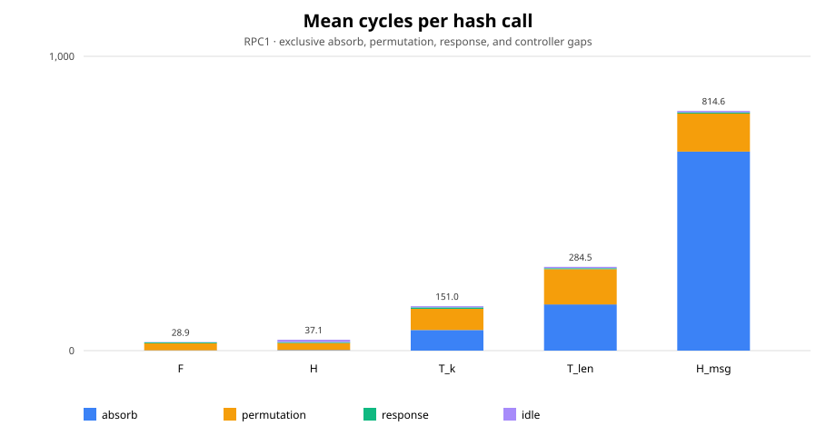

# SLH-DSA-SHAKE-128s verifier

[](https://github.com/EthanFeld/pq-verify/actions/workflows/rtl.yml)

SystemVerilog SLH-DSA-SHAKE-128s signature verifier for the Sipeed Tang Nano 20K. Design includes a shared Keccak/SHAKE datapath, UART host interface, Python reference model, and reproducible FPGA build flow.

## Current board result

<!-- bench-results:start -->
<!-- Generated from validated board evidence by make bench. -->
| Board | Device | Logic cells | FF | BSRAM | Fmax / core clock | Timing margin | Mean latency / comparison | UART verification |
| --- | --- | ---: | ---: | ---: | ---: | ---: | --- | --- |
| Sipeed Tang Nano 20K | GW2AR-18C | 14,504 / 20,736 | 6,718 / 15,552 | 5 / 46 | 43.212 / 38.571 MHz | 10.74% | ≈1.7 ms per verify; 1.9× faster than the first version for 17.5% more logic | 28/28 ACVP; 400/400 generated; 428/428 exact parity |

Bitstream SHA-256: `07b4830a989a5220e681666a5c10f9ea8fea7ac54981d5aa3caa3966785256a7`.
<!-- bench-results:end -->



The selected image passes all 28 ACVP vectors and 400 generated UART cases. Hardware verdicts, cycle counts, and permutation counts match UART-top simulation for all 428 cases. See [hardware evidence](bench/evidence/gowin_c6_board_rpc1/hardware_identity.json) and [results](docs/results.md).

## Architecture


`top_tn20k` connects the UART controller to `slh_verify_top`. H_msg, FORS, WOTS+, and XMSS share `thash`, `shake256`, and `keccak_f1600`. Signature and intermediate data use synchronous RAM.

## Board demo

The Gowin GW2AR-18C image runs at 38.571 MHz from volatile SRAM. [Live UART capture](bench/evidence/gowin_c6_board_rpc1/hardware_demo.txt) shows a valid-signature check. SPI flash was not programmed.

## Quick start

Install Python 3.10+, GNU Make, a C++ compiler, Verilator, Icarus Verilog, Yosys/SymbiYosys with Boolector, `sv2v`, `nextpnr-himbaechel`, and openFPGALoader.

```sh
python -m pip install -r requirements-dev.txt
make test-verify
make formal
make bit-gowin
make load
```

`make load` writes volatile SRAM only. See [building](docs/building.md) for tool setup and board connection.

## Documentation

- [Architecture](docs/architecture.md)
- [Results](docs/results.md)
- [Verification](docs/verification.md)
- [Building](docs/building.md)
- [ASIC considerations](docs/asic.md)
- [UART protocol](docs/protocol.md)
- [Contribution guide](CONTRIBUTING.md)

Developed with AI assistance; design decisions and verification are mine.

## License

MIT. See [LICENSE](LICENSE).
