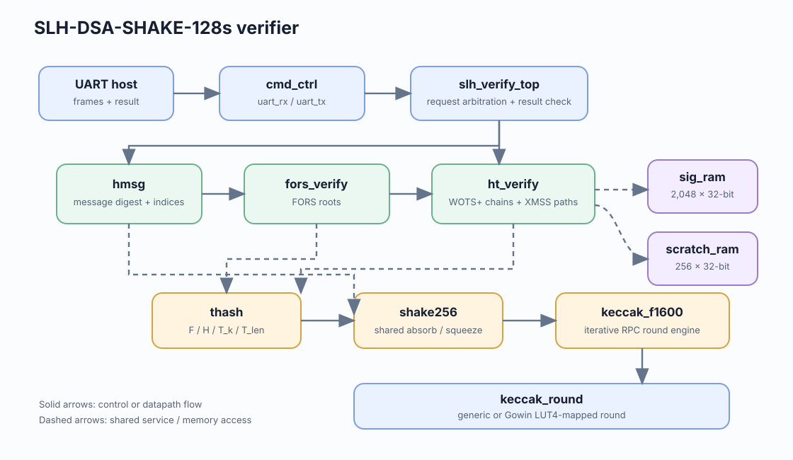

# Architecture

## System overview

`top_tn20k` connects the UART interface to `cmd_ctrl` and `slh_verify_top`. The controller receives the public key, signature, context, and message, then streams them into the verifier. The verifier processes H_msg, FORS, and the seven-layer hypertree before comparing the reconstructed root with the public key root.

## Shared hash datapath

The H_msg, FORS, WOTS+, and XMSS controllers share one `thash`, one `shake256` sponge, and one `keccak_f1600` permutation state. This keeps the FPGA footprint small. Hash requests run sequentially through the shared datapath.

`thash` builds domain-separated inputs for F, H, T_k, and T_len. Register-sourced F/H nodes are packed directly into 64-bit SHAKE lanes. Memory-backed T_k and T_len inputs use the synchronous memory interface. H_msg uses the same SHAKE engine.

The Keccak permutation supports one, two, three, or four rounds per cycle. The Tang Nano 20K image uses one round per cycle and LUT4-mapped round logic.

## Control and storage

Each verification stage has its own finite-state controller and traversal state. `sig_ram` supplies signature words; `scratch_ram` stores intermediate nodes and roots. Synchronous read timing is part of the stage and hash handshakes.

`cmd_ctrl` receives framed UART commands, checks CRC, stages input words, and returns the verification result. `uart_rx`, `uart_tx`, and `crc8` implement serial framing. The Python client is [host/slhv.py](../host/slhv.py).

## Board configuration

The validated configuration uses RPC1, block RAM for scratch storage, and a 38.571 MHz core clock. It fits in 14,504 of 20,736 Gowin logic cells and reaches 43.212 MHz Fmax with zero setup or hold violations. See [current board results](results.md).
